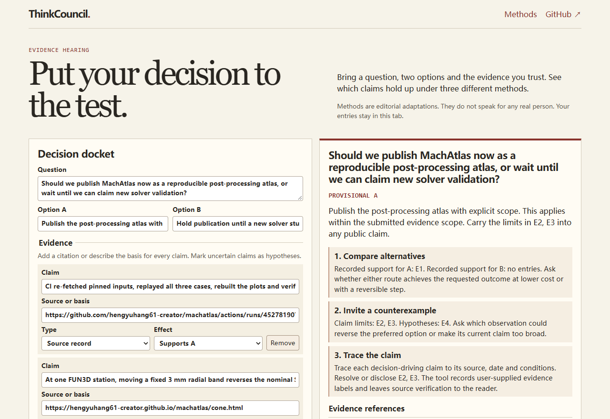

# ThinkCouncil

**Put your decision to the test.**

A browser-based evidence hearing. Draft a question, enter two options and record the source and scope of each claim. Three methods compare alternatives, ask what would change the result, and trace the claims that matter.

[Open the demo](https://hengyuhang61-creator.github.io/thinkcouncil/) · [Release](https://github.com/hengyuhang61-creator/thinkcouncil/releases/latest) · [Report an issue](https://github.com/hengyuhang61-creator/thinkcouncil/issues/new) · [中文](README.zh-CN.md)



The included example asks whether to release MachAtlas as a reproducible atlas or wait for new solver validation. Mark the documented solver-validation gap as supporting Option B instead of limiting the claim, then review again to see the contested outcome.

1. Enter your question and two different options.
2. Add each claim and its source. Indicate whether it supports A, supports B or limits the claim.
3. Review the docket. Qualifying evidence for both options leaves the result contested. Hypotheses invite questions and do not qualify an option on their own.

The rules use the evidence classifications supplied by the editor. Personal data stays in the tab. The methods are editorial adaptations with no impersonation or claim of endorsement, and the app does not independently verify source quality.

## Run locally

```sh
node --test checks.test.mjs
python -m http.server 8000 --directory site
```

Open http://localhost:8000. Use Node.js 24 or compatible for tests. No npm installation, account or API key is needed.

[Watch the actual interaction](media/demo.gif) · [Methods and sources](SOURCES.md) · [Launch copy](PROMOTION.md) · [MIT license](LICENSE)
