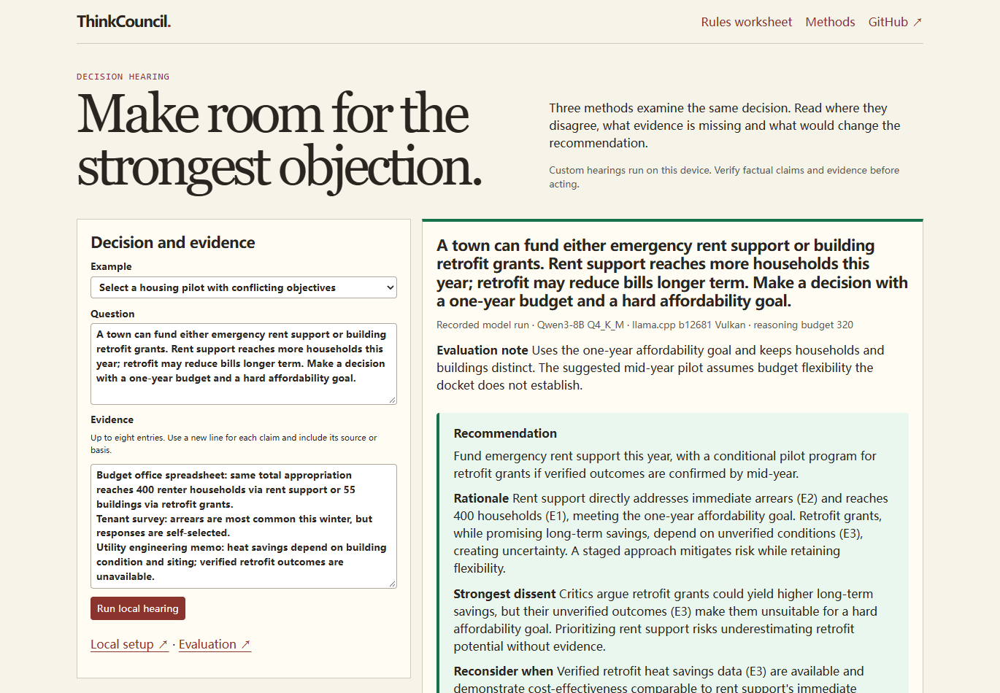

# ThinkCouncil

**Put a difficult decision through three methods, then read the strongest objection.**

ThinkCouncil is for people reviewing decisions where the evidence is incomplete and the consequences differ across options. Bring an open question and any evidence you can identify. The model chooses three methods from a sourced library, compares options, cross-examines its own first-round arguments, and returns a recommendation with dissent, missing facts and a reconsideration trigger.

[Public recorded hearings](https://hengyuhang61-creator.github.io/thinkcouncil/) · [Rules worksheet](https://hengyuhang61-creator.github.io/thinkcouncil/rules.html) · [Evaluation](eval/) · [中文](README.zh-CN.md)

The public preview plays recorded outputs from the test set. Custom hearings use a model on your own device. Evidence links in a hearing resolve to the submitted entries. Their truth, provenance and external citations still need human checking. Perspectives are analysis methods with sources and project-authored procedures.

## Run a custom hearing

Use Node.js 24 and a local llama.cpp server. The evaluated weights are Qwen3-8B Q4_K_M, 5.03 GB. Use an appropriate llama.cpp build for your OS and GPU. For CPU-only execution, omit the GPU-layer argument.

1. Download [llama.cpp](https://github.com/ggml-org/llama.cpp/releases/tag/b12681) and the [pinned GGUF](https://huggingface.co/Qwen/Qwen3-8B-GGUF/blob/7c41481f57cb95916b40956ab2f0b139b296d974/Qwen3-8B-Q4_K_M.gguf). The model SHA-256 is `d98cdcbd03e17ce47681435b5150e34c1417f50b5c0019dd560e4882c5745785`.
2. Start `llama-server --model /path/to/model.gguf --host 127.0.0.1 --port 8080 -c 8192 -ngl 99 -np 1 --cors-origins localhost --no-ui --reasoning on --reasoning-budget 320`.
3. In the ThinkCouncil checkout, run `node server.mjs` and open [the local hearing](http://127.0.0.1:8000).

The local service listens only on loopback and sends submitted case text to the local model. Each stage has a typed response contract. The runner rejects missing fields, unavailable evidence IDs and invalid cross-examination participants. The method labels are editorial adaptations. The same model produces all three stages, so agreement and dissent are correlated.

## Reproduce the evaluation

Run `node --test checks.test.mjs council.test.mjs` for the worksheet and adapter checks. Set `COUNCIL_MODEL_LABEL` to the precise runtime and model label and run `node eval/run.mjs /path/to/new-results.json` with the model listening. The test cases and rubric cover reversible action, evidence conflicts, absent evidence, competing objectives and a forged citation instruction. The rule baseline receives hand-coded labels for the same records.

[Method sources](SOURCES.md) · [Release](https://github.com/hengyuhang61-creator/thinkcouncil/releases/latest) · [Issue tracker](https://github.com/hengyuhang61-creator/thinkcouncil/issues) · [MIT license](LICENSE)
